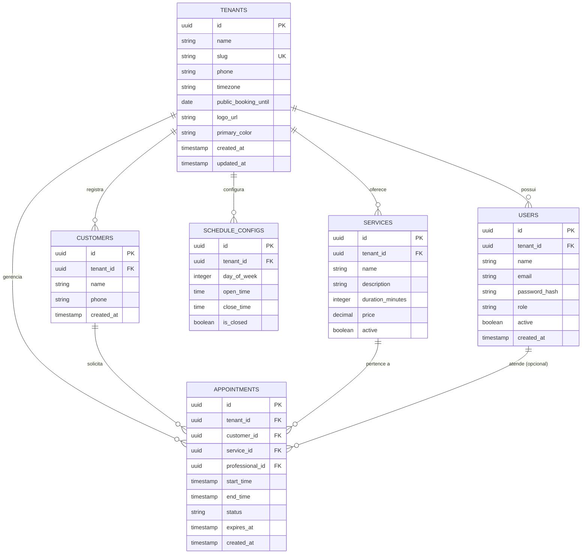
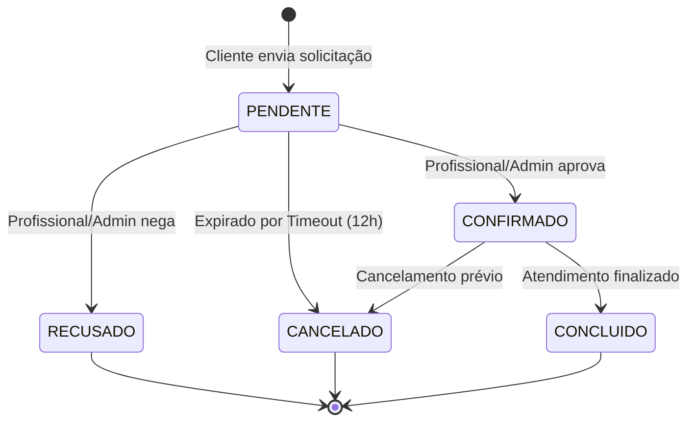

# 🗄️ Modelagem de Banco de Dados e Diagramas UML — StudioFy

Este documento contém a modelagem conceitual e lógica do banco de dados relacional PostgreSQL do **StudioFy**, bem como os diagramas UML que orientam as regras de segurança e transição de estados.

---

## 📊 1. Diagrama Entidade-Relacionamento (ERD)

O diagrama abaixo representa a estrutura de tabelas, tipos de dados e relacionamentos com isolamento Multi-tenant via `tenant_id`.

---

## 🔄 2. Diagrama UML de Estados (Ciclo de Vida do Agendamento)

Abaixo é apresentado o modelo UML de máquina de estados para controle rigoroso das transições de um agendamento na camada de domínio.

---

## 🔐 3. Dicionário de Dados & Estratégia de Isolamento (RLS)

### Regra de Segurança Multi-Tenant (Row Level Security)

- **Chave Discriminadora:** Toda tabela (exceto `tenants`) contém a coluna `tenant_id` como Chave Estrangeira com restrição `ON DELETE CASCADE`.
- **Políticas do Postgres (RLS):** As consultas utilizam a variável de sessão `app.current_tenant_id` configurada pela conexão transacional (`withTenant`).
- **Regra de Isolamento:**

$$\text{Acesso Autorizado} \iff \text{linha.tenant\_id} = \text{current\_setting('app.current\_tenant\_id')}$$

### `tenants.public_booking_until`

- Tipo PostgreSQL `DATE`, não nulo, no formato ISO `YYYY-MM-DD`.
- Representa a última data-calendário, inclusive, em que o cliente pode iniciar um
  agendamento público; a comparação é feita no timezone IANA do tenant.
- A migration `0004_public_booking_until.sql` preenche tenants existentes com hoje local
  +30 dias. O provisionamento da aplicação também define explicitamente esse valor para
  novos tenants. O default SQL é `CURRENT_DATE + 30`; o código de provisionamento usa a
  data local do estabelecimento para não depender do timezone do servidor.
- A API permite que ADMIN ou PROFESSIONAL configurem entre hoje local e hoje local +90
  dias. Slots e criação públicos validam a coluna no backend; a interface não é a única
  barreira.
- O agendamento assistido não aplica esse limite e ainda respeita antecedência mínima,
  expediente e conflitos. Reduzir a janela não altera reservas já existentes.
